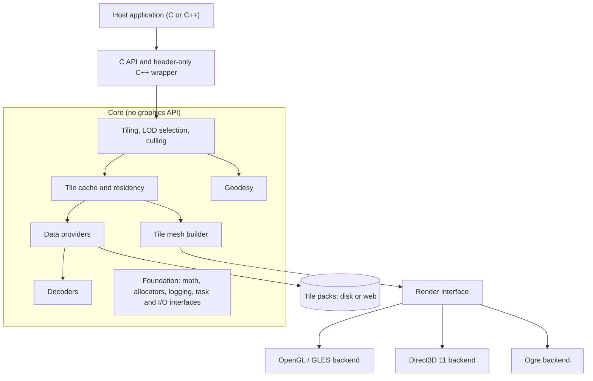
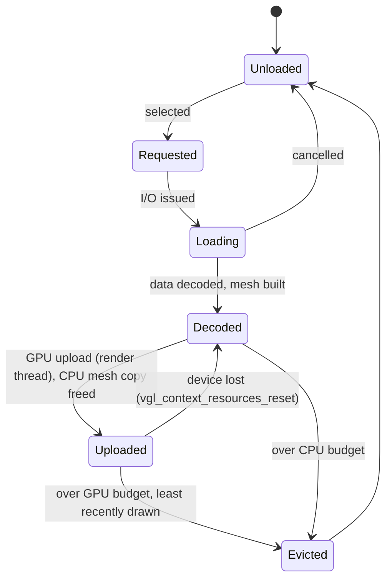
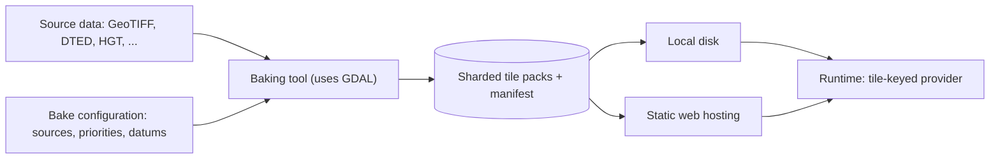

# vgl (Virtual Globe Library): Design Document

| | |
|---|---|
| **Status** | Draft 0.1 |
| **Date** | 13 October 2026 |
| **Author** | Jeremiah van Oosten |
| **Scope** | Architecture, requirements, data pipeline and roadmap. No implementation. |

The project is named **vgl** (Virtual Globe Library). This document refers to it as "the library". C API identifiers use the `vgl_` prefix and the C++ wrapper uses the `vgl` namespace (section 7.1).

---

## 1. Introduction

### 1.1 Purpose

This document describes the planned design of a lightweight C++ library for rendering a virtual globe. It covers the target audience, requirements, architecture, data pipeline and roadmap, and it records the decisions made so far, including how the questions that were once open were settled (section 16). It is also intended to confirm the requirements with prospective users, such as the client whose C project motivated the library, before implementation starts.

### 1.2 Background

The closest existing reference is Cesium Native, a set of C++ libraries for 3D Tiles streaming, glTF, high-precision geospatial math and raster overlays. Cesium Native does not render anything itself. Rendering is done by the integrations built on top of it (Cesium for Unreal, Unity, Omniverse and O3DE). It also consists of roughly two dozen libraries, including networking and cloud service clients, with a substantial dependency tree.

This library takes a different position in two ways. First, it renders: it ships with backends for specific graphics APIs and engines. Second, it is deliberately small. It has a narrow format scope, a minimal set of runtime dependencies, no built-in networking, no threads of its own and bounded memory use.

### 1.3 Summary of key decisions

| Topic | Decision |
|---|---|
| Implementation language | C++20 |
| Public ABI | C API, with a header-only C++ wrapper on top |
| Target platforms | Windows 10, Linux, macOS 11 (Apple silicon and Intel), Android 7.0 (API 24, 64-bit) and iOS 15 for the runtime, which is platform-independent; Windows and Linux for the baker (section 4) |
| Backends | OpenGL 3.3 / GLES 3.0 common subset first, then Direct3D 11, then Ogre 14 (the classic line, 14.6.0 when decided; not Ogre-Next) |
| Elevation data | Free global datasets (Copernicus GLO-30, GEBCO), baked offline; oceans with their bathymetry, and an optional sea surface (section 7.6) |
| Imagery | Free datasets: NASA Blue Marble Next Generation as the global base, Sentinel-2 cloudless 2016 for detail (section 9) |
| Runtime data format | Custom, sharded, range-readable tile packs |
| Data access | Local disk first; web hosting later, through the same interface, recommended on an object store without egress fees (section 10.2) |
| Tiling scheme | Geographic (latitude/longitude) quadtree with two root tiles |
| Geoid | EGM2008 2.5′ grid, baked into a geoid pack and streamed like terrain |
| License | MIT |
| Repository | github.com/3dgep/vgl |

---

## 2. Goals and non-goals

### 2.1 Goals

The library should render a WGS84 globe with streamed, level-of-detail terrain and imagery inside a host application that owns the window, main loop, camera and render target. It must be usable from C as easily as from C++, so that it can be embedded in an existing C code base. It must run on Direct3D 11, OpenGL, OpenGL ES and Ogre through a shared backend interface, on desktop and mobile platforms, and its core must also be usable without any backend by a host with its own renderer. Elevation and imagery data are prepared offline by a bundled baking tool and read at runtime from local files or a plain web server. The library is an open-source project hosted on GitHub, and it should be easy both to use and to extend (section 13).

### 2.2 Non-goals

The following are explicitly out of scope for the first releases: 3D Tiles and glTF streaming, text and label rendering, vector tile styling, time-dynamic data, clients for online services (Cesium ion, Google, Bing), general map reprojection at runtime, and a built-in HTTP stack. Several of these may be reconsidered later (see section 14), but the architecture should not be shaped around them.

---

## 3. Target audience and use cases

The library is "embedded" in the sense of being embeddable in a host application, rather than targeting embedded hardware. It has two kinds of users.

**Integrators** add a globe view to an existing application. The client's C project is the primary example and the main design driver. Integrators need a small, stable C API, predictable resource use, and a library that cooperates with their existing rendering instead of taking it over.

**Engine users** want the globe inside a scene graph. For them, the Ogre backend maps globe tiles onto the engine's own objects and materials. vgl targets Ogre 14, the continuation of the classic 1.x line (14.6.0 when this was decided); Ogre-Next is not supported.

Typical applications include simulation and training, mission and route planning, moving-map displays, and visualization tools that need a 3D geographic context. Many of these involve a vehicle or aircraft positioned on the terrain, which makes height queries and correct depth interaction with host geometry important requirements.

---

## 4. Platform and toolchain

The runtime targets Windows, Linux, macOS, Android and iOS, on desktop and mobile hardware. It must stay as platform-independent as possible. The baker runs on Windows and Linux only; it never runs on a mobile device.

The rules that keep the runtime portable:

- The core uses only the C and C++ standard libraries. It never calls an operating system API: files, network and threads all go through host callbacks (sections 7.5 and 13.1), which is also how an Android host reads from its APK assets and an iOS host from its app bundle.
- No `std::filesystem`, `std::thread` or locale-dependent formatting in the core. The optional defaults module (section 6.2) may use threads and files, and is built only where they exist.
- Data formats are little-endian and read byte by byte (pack format, section 3), so no part of the runtime depends on the host's endianness or alignment.
- The library builds as a static library, which mobile platforms prefer, as well as a shared one, and CI builds it for every target platform.

Graphics APIs by platform:

| Platform | Raw backends | Ogre backend |
|---|---|---|
| Windows | Direct3D 11, OpenGL | Direct3D 11, OpenGL 3+, Vulkan |
| Linux | OpenGL | OpenGL 3+, Vulkan |
| macOS | OpenGL 3.3 core (deprecated by Apple since macOS 10.14, but available up to 4.1) | Metal |
| Android | OpenGL ES 3.0 | OpenGL ES 3, Vulkan |
| iOS | OpenGL ES 3.0 (deprecated by Apple since iOS 12, but available) | Metal |

OpenGL ES 3.0 is therefore a target from the first releases, not just a possibility: the OpenGL backend targets the common subset of OpenGL 3.3 and OpenGL ES 3.0 (section 7.6). OpenGL ES 2.0 is out of scope. A raw Metal backend is not planned; on macOS and iOS, rendering goes through OpenGL, OpenGL ES or Ogre's Metal render system. On macOS the OpenGL backend needs no extensions beyond OpenGL 4.1, the last version Apple ships, so clip control is unavailable there too and the logarithmic depth path applies.

Minimum versions and architectures, chosen as recommended defaults rather than client requirements (section 16):

| Platform | Minimum | Architectures | Reason |
|---|---|---|---|
| Windows | 10 | x64 | Windows 11 runs on all supported hardware; arm64 when asked for |
| Linux | glibc of Ubuntu 22.04 | x86_64, aarch64 | The oldest distribution still in common long-term support |
| macOS | 11 | arm64 and x86_64, as universal binaries | The first release for Apple silicon; Intel Macs are still in use and cost only a second slice |
| Android | 7.0 (API 24) | arm64-v8a; x86_64 for the emulator | Covers nearly all devices with OpenGL ES 3; Google Play requires 64-bit code, so 32-bit ARM is not supported |
| iOS | 15 | arm64 | Covers nearly all devices in use, and what current Xcode releases support |

Public structures stay free of padding on 32-bit targets anyway (C API conventions, section 8.2), so 32-bit support can be added later without an ABI change.

The client's toolchain includes a C++ compiler, so the C API wraps a C++ implementation and no part of the core needs to be written in C. The baseline language level is C++20, which current desktop compilers, the Android NDK (Clang with libc++) and Xcode's Apple Clang all support.

---

## 5. Requirements

### 5.1 Functional requirements

| ID | Requirement |
|---|---|
| FR-01 | Render the WGS84 ellipsoid with terrain and imagery at continuously varying level of detail. |
| FR-02 | Select tiles by screen-space error, with view frustum and horizon culling. |
| FR-03 | Read elevation and imagery from baked tile packs on local disk. |
| FR-04 | Read the same packs from a web server through a host-supplied I/O callback, without changes to the core. |
| FR-05 | Stack several packs per layer by priority, so regional packs refine a global base. |
| FR-06 | Answer height queries at any latitude and longitude, as ellipsoidal height or height above mean sea level, at the best resolution currently loaded. |
| FR-07 | Support picking: intersect a ray with the ellipsoid and the loaded terrain. |
| FR-08 | Expose attribution strings for the data currently visible, so the host can display credits. |
| FR-09 | Provide geodetic utilities: geodetic, ECEF and local East-North-Up conversions. |
| FR-10 | Expose a backend-independent description of visible tiles, so a host can render with its own engine. |
| FR-11 | Provide a baking tool that converts source elevation and imagery into tile packs. |

### 5.2 Non-functional requirements

| ID | Requirement |
|---|---|
| NFR-01 | The public ABI is a C API. It is stable across compilers and standard library versions. |
| NFR-02 | The library never creates threads or opens network connections itself. |
| NFR-03 | All allocations can be routed through host-supplied allocator callbacks. |
| NFR-04 | CPU cache and GPU residency are bounded by budgets set at context creation. |
| NFR-05 | No exceptions cross the API boundary. The library can be built without exceptions and RTTI. |
| NFR-06 | No global state: all state lives in an explicit context object. |
| NFR-07 | The runtime has minimal third-party dependencies. Heavy dependencies (GDAL) are confined to the baking tool. |
| NFR-08 | The backends restore any graphics state they change, and document which state they touch. |
| NFR-09 | No visible jitter at any camera distance, from orbit down to ground level. |
| NFR-10 | The library works in a single-threaded host, using a time-budgeted synchronous update. |

---

## 6. Architecture

### 6.1 Overview

The library separates a renderer-independent **core**, which turns geospatial data into GPU-ready data, from **backends**, which draw it. The core never calls a graphics API. This keeps the backends small and makes the core usable on its own.

### 6.2 Modules

| Module | Responsibility |
|---|---|
| Foundation | Allocator hooks, logging callback, double-precision math, task and I/O callback interfaces |
| Geodesy | Parameterized ellipsoid (WGS84 by default), coordinate conversions, geoid model, bounding volumes |
| Tiling and selection | Geographic quadtree, screen-space error, frustum and horizon culling, load prioritization |
| Cache and residency | Tile state machine, CPU and GPU budgets, least-recently-used eviction |
| Data providers | Tile-keyed access to packs, layering by priority, shard lookup |
| Decoders | Elevation and image decoding, pluggable so a host can substitute its own |
| Tile mesh builder | Terrain meshes from heightmaps, skirts, normals, imagery texture coordinates |
| Render interface | The contract between core and backends |
| Backends | OpenGL / GLES, Direct3D 11, Ogre |
| Optional defaults | Thread pool and filesystem reader, used by the samples and available to hosts |

### 6.3 Host integration model

The host owns the window, the main loop, the camera and the render target. Each frame, the host passes the camera (in double precision) and the viewport to the library and calls an update function, which advances loading and selection within a time budget. It then asks the backend to draw the globe into the host's current render pass. The library never presents, swaps buffers or clears the render target.

---

## 7. Detailed design

### 7.1 Public API and ABI

The C API follows these conventions, which are specified in full in the [C API conventions](c-api.md):

- All objects are opaque handles with explicit create and destroy functions.
- Every function returns a result code. There are no exceptions and no `errno`-style global error state.
- Option structures carry a version tag or size field, so new fields can be added without breaking the ABI.
- Positions and distances crossing the API are double precision.
- Callbacks take a user-data pointer.
- The thread-safety of each function is documented.

The header-only C++ wrapper adds RAII handles, spans, enum classes and error reporting on top of the C API. It does not introduce a second ABI, so C and C++ users link the same binary.

Naming follows a fixed convention. Functions use lowercase snake case with the `vgl_` prefix, naming the object before the action (for example `vgl_context_create`). Types use the same prefix (`vgl_context`, `vgl_result`). Constants and macros use `VGL_`, followed by the type name and the value (for example `VGL_RESULT_OUT_OF_MEMORY`). The C++ wrapper lives in the `vgl` namespace.

### 7.2 Geodesy and coordinate systems

All CPU-side geometry is double precision. The geodesy module provides conversions between geodetic coordinates, Earth-centred Earth-fixed (ECEF) coordinates and local East-North-Up frames, plus oriented bounding boxes and bounding spheres for tiles. The ellipsoid is a parameter rather than a constant, which costs nothing now and makes other bodies (the Moon, Mars) possible later.

Terrain heights are stored relative to the WGS84 ellipsoid. A geoid model (EGM2008) lets the library convert to and from height above mean sea level, which users of height queries will usually expect. The geoid is baked from the official EGM2008 2.5′ grid into a geoid pack at 2.64′ spacing, a pack with its own layer type, and is loaded through the same providers as terrain ([pack format specification](pack-format.md), section 6.4). A context uses at most one geoid pack. Until it has loaded, height queries report ellipsoidal heights only, and queries for heights above mean sea level return `VGL_RESULT_NOT_READY`.

### 7.3 Tiling scheme and level of detail

Terrain and imagery share one geographic quadtree. Level 0 has two root tiles of 180° by 180°, and each level splits every tile into four. Tile addressing and sample placement are defined in the [pack format specification](pack-format.md), section 2. The scheme covers the poles, which Web Mercator cannot, and matches how source elevation data is usually gridded. Because imagery and terrain tiles align one-to-one, building meshes and mapping textures onto them stays simple.

Tile selection uses screen-space error: a tile is refined when its geometric error, projected to the screen, exceeds a threshold in pixels. Tiles outside the view frustum, or hidden below the horizon, are culled. Culling a tile before its children are loaded requires their bounds, so each tile records the minimum and maximum heights of its children (see section 8.4).

Pyramids are sparse. High resolution exists only where the source data supports it, and each tile carries a child-existence mask so the runtime knows whether refining is possible.

#### Selection

Before each update, the host sets its view with `vgl_context_view_set`: a view matrix from ECEF to camera space, a projection matrix and the viewport size, all in double precision. The update then selects tiles for it; without a view, nothing is selected. Selection derives everything else from these, and is independent of handedness and depth convention: it culls against the four side planes of the frustum and the plane through the eye, and ignores the near and far planes, which differ between OpenGL, Direct3D, reversed and infinite projections. The eye position comes from the inverse of the view matrix.

- **Geometric error.** The error of drawing a tile at level *L* instead of its children is its sample spacing at the equator, *a* · Δλ / (*n* − 1), for tile span Δλ in radians and *n* samples per side.
- **Screen-space error.** The geometric error times *P*₁₁ · *H* / (2*d*), for projection element *P*₁₁, viewport height *H* in pixels and distance *d* from the eye to the tile's bounding box; an orthographic projection drops *d*. A tile is refined when this exceeds `vgl_view::max_screen_space_error`, 2 pixels by default.
- **Bounds.** A loaded tile is bounded by its own decoded heights, a tile not yet loaded by the child bounds in its parent, and a root tile by a conservative range for the Earth, −11,500 m to 9,000 m. Bounding boxes are cached, since a level-0 box takes tens of thousands of conversions to compute.
- **Horizon culling.** A tile is culled when it is hidden behind the ellipsoid lowered to the lowest possible height, tested in the scaled space where that ellipsoid is a unit sphere. Each tile has a horizon point that is hidden only if the whole tile is (the method of Cesium's `EllipsoidalOccluder`), and the corners of its box are tested too; the hidden region is convex, so hidden corners hide the box.
- **Large tiles.** The box of a tile tens of degrees wide reaches far below the surface, where it can cross the view even though the surface does not. A tile coarser than level 6 is therefore drawn only if the box of one of its level-6 descendants is in view.
- **Refinement.** A tile is refined only once its own data has loaded, so detail arrives level by level without holes. Until a child has loaded, it is drawn from its nearest loaded ancestor. A child that no pack contains is drawn the same way, and a region no pack covers is drawn as the bare ellipsoid. A newly selected tile also gets a placeholder at once: a 9 × 9 mesh interpolated from the same heights, cheap enough to build within the update whatever its time budget, and uploaded ahead of everything else, outside the upload budget. Where nothing drawn in the last frame covers a tile, the placeholder is drawn until the tile's own mesh is ready, from the frame that creates it on (render interface, section 4.2), so that no region is ever empty while its meshes build and upload. Finer terrain still in view is never replaced by a coarser stand-in. With several packs, a tile's data comes from the highest-priority pack that has loaded it, and a child exists if any pack has it.
- **Loading.** Selection requests the tiles it needs, coarser levels first and then larger screen-space errors first, with a cap on outstanding reads. Selected tiles count as used in the frame, so eviction keeps them.
- **Imagery.** Imagery packs take part in selection without supplying terrain. Their tiles load with the terrain's, and where they have children, tiles refine even beyond the terrain's deepest level, drawn from an ancestor's terrain. The screen-space error stays the terrain's: at the level it selects, a 256-pixel imagery tile over a 129-sample terrain tile gives about one texel per pixel. A tile with terrain refines without waiting for its imagery, which an ancestor's texture stands in for meanwhile.

#### Tile textures

Imagery tiles are cached encoded, as read, and count towards the CPU budget at a few kilobytes each. When a selected tile wants imagery, the deepest loaded imagery tile over it is decoded on a task thread with stb_image, into RGBA8 with a full chain of mip levels, and offered as a texture (render interface specification, section 7). The pixels are freed once the consumer has created it. One texture serves every tile drawn with that imagery tile, and each drawn tile gets one layer per imagery pack: the deepest resident texture over it, mapped into the part of an ancestor's texture that the tile covers. A texture evicted from the GPU, or lost with the device, is decoded again from the cached tile when wanted.

#### Tile meshes

Each selected tile gets a mesh, built from heights on a task thread (or in the update without one):

- **Vertices.** 24 bytes: the position as three `float`s relative to the tile's centre along the ECEF axes, the height above the ellipsoid as a `float` (for shading without imagery), texture coordinates over the tile as two 16-bit unsigned normalized values (*u* east, *v* south, matching the imagery tile), and the normal as two 16-bit signed normalized values in octahedral encoding. Normals come from neighbouring sample positions, computed in double precision.
- **Grid.** A tile with its own data has one vertex per sample, or fewer (below). A tile drawn from an ancestor uses the ancestor's samples in its part of the ancestor, interpolated up to at least 9 × 9. The bare ellipsoid has vertices at most 1.5° apart, and at least 9 × 9.
- **Coarser grids.** A tile that can refine is drawn only while its geometric error stays under the screen-space error, so its samples are a pixel or two apart where it is closest to the camera, and closer still elsewhere: from orbit, meshes of every sample drew about ten triangles per pixel. Such a tile, with its own data and children, therefore takes every second, fourth, eighth or sixteenth sample, the largest stride at which every sample lies within half its geometric error of the coarser mesh, measured in three dimensions so that the ellipsoid's curvature counts as much as the terrain, and keeps at least 9 × 9 vertices. The visible error stays within a pixel. Tiles that cannot refine may be seen from any distance, and keep every sample.
- **Samples.** Each mesh also carries the samples it was built from at full resolution, a height and a normal each, which consumers shade from (render interface specification, section 6). Height colours, contours, the sea surface's coastline and lighting then keep their detail on a coarser mesh; interpolated from its vertices, they would not.
- **Nodata.** A nodata sample takes the height from the deepest loaded ancestor-or-self tile that has data there, from the tile's pack and then from the lower-priority packs; with none, it lies on the ellipsoid. Regional packs therefore blend into the global base without holes.
- **Skirts.** A ring of vertices along the tile's boundary hangs down to the tile's lowest height minus its geometric error, with the normals and texture coordinates of the edge above, hiding cracks between neighbouring tiles at different levels.
- **Indices.** Every tile with the same grid size shares one index list: triangles counter-clockwise seen from outside the ellipsoid, in right-handed ECEF.
- **Memory.** Meshes and their samples count towards the CPU budget until they are uploaded, and are evicted least recently used, like decoded tiles; after upload, only the GPU copy remains (section 7.4). A tile keeps its previous mesh until the new one is built, so finer data replaces coarser without gaps.

### 7.4 Tile lifecycle, cache and memory

Each tile moves through a fixed state machine:

Budgets for CPU cache memory and GPU residency are set when the context is created. Once a mesh or texture is uploaded, its CPU copy is freed and only the GPU copy counts, against the GPU budget; after a device loss, the host calls `vgl_context_resources_reset` and the resources are rebuilt from the decoded tiles ([render interface specification](render-interface.md), section 4.4). Eviction is least-recently-used, but never removes tiles that are needed to render the current frame. The render path performs no allocations. A statistics query reports cache use, residency, queue depth and load times.

### 7.5 Threading and I/O

The library never spawns threads or opens sockets (NFR-02). The host supplies two callbacks:

- **Task scheduling.** The library submits decode and mesh-building work through a host callback. If no callback is supplied, the update function does this work synchronously within its time budget.
- **I/O.** The library requests data by URI and byte range through a host callback, and receives the result asynchronously.

GPU uploads happen only on the render thread, in a budgeted step at the start of each frame. The frame functions must not overlap with `vgl_context_update`; a host that updates and renders on different threads serializes the two ([render interface specification](render-interface.md), section 9).

The optional defaults module provides a small thread pool and a filesystem reader, so the common case works without writing callbacks. The samples use these defaults. It is a separate library, `vgl::defaults`, that uses vgl only through the C API.

A context may be destroyed while reads are outstanding or tasks are queued. The state those need is reference counted and outlives the context, so a late completion or task finds the context gone and frees itself; the host never has to drain its queues first (C API conventions, section 12).

### 7.6 Rendering

#### Backend interface

The interface is resource-oriented, not draw-call oriented. The core tells the backend when a tile's mesh or texture becomes available, changes or is evicted. Each frame, it hands over the visible set with per-tile transforms and parameters. The Direct3D 11 and OpenGL backends turn that into draw calls. The Ogre backend turns it into renderables in Ogre's scene graph. If the interface fits both a raw graphics API and a scene-graph engine, it is general enough for hosts that want to render the visible set themselves (FR-10). The [render interface specification](render-interface.md) defines it: each frame, on the render thread, a backend or host pulls resource lists (meshes, shared index lists and textures to destroy and create, within an upload budget) and a draw list with `float` model-view matrices composed in double precision; the core never calls into it.

The material model is deliberately narrow: a terrain tile with a number of blended imagery layers. Texture formats are negotiated per backend from the start, so compressed formats (BC1 and BC7 on desktop, ETC2 and ASTC on mobile) can be added later without changing the interface. With Android and iOS among the targets, ETC2 and ASTC matter as much as BC1 and BC7.

#### Precision

GPU vertex positions are single precision and stored relative to each tile's centre. The model-view matrix for each tile is composed in double precision on the CPU and converted to single precision only at the end. This removes vertex jitter at all camera distances (NFR-09).

#### Depth

Planet-scale rendering needs a very large depth range. The primary approach is reversed-Z with a 32-bit floating-point depth buffer, which Direct3D 11 supports directly and OpenGL supports through clip control (OpenGL 4.5 or `ARB_clip_control`). Where clip control is unavailable, as on GLES and so on every Android and iOS device, the backend falls back to a logarithmic depth buffer computed in the shader.

The depth convention is exposed to the host, because host geometry such as an aircraft on the terrain has to depth-test correctly against the globe.

#### State hygiene

The Direct3D 11 and OpenGL backends draw into the host's context. Each backend documents exactly which state it changes and restores that state before returning (NFR-08).

#### OpenGL and OpenGL ES backend

The backend targets the common subset of OpenGL 3.3 core and OpenGL ES 3.0. Desktop-only features are allowed only as detected, optional enhancements. In practice, this means the following:

- Shaders use the shared GLSL 3.30 / 3.00 ES dialect, with a version and precision preamble. There are no geometry or tessellation shaders and no double-precision arithmetic in shaders.
- Clip control is an enhancement. The logarithmic depth path is maintained and tested even though desktop drivers rarely need it.
- There are no BGRA uploads, no RGB8 render targets and no other desktop-only formats.
- Buffers, vertex array objects, samplers and uniform buffers are used only in ways that exist in ES 3.0. Wireframe rendering is a debug-only feature.
- Context creation belongs to the host, so EGL, WGL and GLX never appear in the library.

The backend (`vgl/gl.h`, target `vgl::gl`) is a consumer of the render interface in a library of its own, built on the C API like a third-party backend. It is implemented as follows:

- **Functions.** The host passes a function loader, such as `glfwGetProcAddress`, when it creates the backend. The backend declares the part of OpenGL it uses itself, the same in OpenGL and OpenGL ES, and links no OpenGL library, so the same binary serves both.
- **Memory and messages.** It allocates through the context's allocator and logs through the context's log (`vgl_context_allocator_get`, `vgl_context_log`), and takes the projection from the context's view unless the host passes one.
- **Drawing.** Each mesh has its own buffer and vertex array, which also binds the shared index list's buffer, so a tile is one draw call: a vertex array, a model-view uniform and `glDrawElements`. Plain uniforms rather than uniform buffers keep the path the same on OpenGL ES. Index lists upload through `GL_COPY_WRITE_BUFFER`, because the element array binding belongs to whichever vertex array is bound, which may be the host's.
- **Shading.** A tile blends up to four imagery layers, with one sampler for all textures: trilinear, anisotropic where the device has it, clamped to the edge. Under the imagery, and where there is none, a palette by height from the deep ocean floor to snow shows through. The result is lit by the normal, from a sun direction the host passes or else from the camera. Height and normal come from the mesh's samples, uploaded as a texture of two 32-bit unsigned integers per texel (the height's bits and the normal's two halves) and interpolated bilinearly in the shader, since integer textures do not filter and OpenGL ES 3.0 filters no 32-bit float format without an extension.
- **State.** `vgl/gl.h` lists the state the backend changes and restores. Primitive restart is switched off while it draws, because a 16-bit index list may use index 65,535 as a vertex. For the reversed-Z convention, it sets the clip control depth mode and keeps the host's origin.
- **Debug views.** `vgl_gl_draw_info::debug_flags` turns on a wireframe of the mesh's grid cells over the shading (where they crowd, every second, fourth or further line, so that it stays readable) with the tiles' boundaries in yellow, a tint per tile level with the tiles' borders outlined, a tint where a tile's imagery comes from an ancestor (orange) or is missing (magenta), colours by height instead of imagery, and contour lines at an interval the host sets, a pixel wide at every distance. The contours follow heights above the ellipsoid, which differ from those above mean sea level by the geoid height. The other backends are to offer the same views.
- **Lost contexts.** `vgl_gl_backend_reset` forgets the objects of a lost OpenGL context without deleting them, loads the functions again on the new context, and resets the context's resources, which are then uploaded again over a few frames.

Continuous testing keeps the GLES path working. The OpenGL sample's check draws the sample data from five views with each depth convention, compares the images across conventions and with the expected coverage, and checks for OpenGL errors and that the host's state is restored. CI runs it on OpenGL and on OpenGL ES with Mesa under a virtual X server; a run through ANGLE on Windows is to follow.

#### Direct3D 11 backend

The backend targets Direct3D 11 at feature level 11_0. Direct3D 12 offers little benefit for a globe renderer and would make the backend several times larger, so it is not planned.

#### Ogre backend

The backend targets Ogre 14, the classic line (14.6.0 when this was decided); Ogre-Next is not supported. Classic Ogre has no HLMS: tiles become custom renderables with their own hardware buffers, drawn with a small vgl material. Its shaders cover the render systems of section 4: Direct3D 11, OpenGL 3+ (Ogre's reference render system), OpenGL ES 3, Vulkan and Metal. Ogre provides the render systems, so this backend never touches a graphics API directly, and it is the main rendering path to Metal on Apple platforms. Its depth configuration has to match the conventions of the other backends.

#### Sea surface

Terrain includes the ocean floor (section 9), since some applications want bathymetry. An optional sea surface covers it: where the terrain lies below mean sea level, backends can draw water at the height of the geoid, so applications that want a flat sea get one without a separate dataset. The geoid pack provides the height, which reaches the backends as the geoid's height at each drawn tile's corners, interpolated over the tile ([render interface](render-interface.md), section 5). The OpenGL backend draws the sea surface on request (`vgl_gl_draw_info::sea_surface`): terrain below mean sea level is raised to it and shaded as water, with the imagery's ocean colour where there is imagery. Its colours by height and contour lines use heights above mean sea level too.

---

## 8. Data pipeline

### 8.1 Overview

The runtime reads only baked tile packs. All handling of source formats takes place in an offline baking tool that ships with the library but never runs inside the client's application.

### 8.2 Baking tool

The baker is a command-line tool built on a library, so a graphical front end can be added later. It uses GDAL to read source formats, reproject and mosaic. GDAL is MIT-licensed and is confined to the baker (NFR-07). Proprietary formats such as ECW and MrSID need vendor SDKs and are not supported.

The baker and the runtime link the same geodesy and tiling module, so tile addressing, bounds and sample placement have a single source of truth. A mismatch of even half a sample would produce seams.

A configuration file lists the sources with their priorities, vertical datums and nodata handling, together with the output settings. Where sources overlap, the higher-priority source wins.

A full global bake runs for many hours, so the baker is multithreaded, resumable and deterministic. Work is partitioned into units that match the output shards (section 8.5). A failed unit can be rerun on its own, units can be distributed across machines, and a regional update is simply a smaller job list. A separate validation command reports coverage and level counts and checks for seams. A fast preview mode, such as GLO-90 only or a limited number of levels, produces a test dataset in minutes.

### 8.3 Vertical datums

Source datasets use different height references. Copernicus DEM heights are relative to the EGM2008 geoid, NASADEM to EGM96, and GEBCO is effectively mean sea level. Geoid and ellipsoid differ by up to about 100 metres. Each source in the bake configuration therefore declares its vertical datum, and the baker converts all heights to WGS84 ellipsoidal heights. For EGM2008 it uses the same geoid pack and interpolation as the runtime, so that converting a baked height back to mean sea level reproduces the source height. Without this step, visible steps of tens of metres would appear where packs from different sources meet. The datum used is recorded in the pack metadata.

### 8.4 Tile encodings

**Elevation.** Elevation tiles are regular heightmap grids, not pre-triangulated meshes. A grid is simple to bake, the runtime builds the mesh, and height queries and picking are exact and cheap. The stored tile size is 129 × 129 samples, including the border row and column shared with neighbouring tiles. Samples are 16-bit integers with a per-tile scale and offset, compressed losslessly with a predictor and Zstandard. All tiles of one level share the same scale, and offsets are multiples of it, so the shared border samples of neighbouring tiles decode to identical heights. Cracks between tiles at different levels are hidden by skirts generated at runtime.

Each tile also stores a four-bit child-existence mask and the minimum and maximum heights of its children, for culling (section 7.3).

Coarser levels are built bottom-up by filtering. The default filter averages. A maximum-preserving filter is available as a bake option for applications such as aviation, where terrain should never appear lower than it really is.

**Imagery.** Imagery tiles are 256 or 512 pixels square, stored as JPEG or WebP when opaque and PNG when alpha is needed. The baker writes 256-pixel tiles with a one-pixel border from the neighbouring tiles by default, so that textures filter across tile edges without seams, as JPEG where a tile has data everywhere and as PNG with alpha elsewhere. The baker can optionally pre-encode tiles to BC1 or BC7, which the runtime can then upload without decoding.

### 8.5 Pack format

The runtime format is a custom, range-readable pack format, inspired by PMTiles, and is specified in full in the [pack format specification](pack-format.md). PMTiles itself is built around Web Mercator tile identifiers and does not fit the geographic scheme.

**Sharding.** A global 30-metre dataset is far too large for a single file. Each layer is therefore split into shards, each holding one subtree of the quadtree, rooted five levels above the pack's deepest level by default (one shard per level-7 tile for GLO-30 at level 12), which the test bake found to give shards of about 10 to 25 MB. Levels above the shard level go into one base shard. A small manifest describes which shards exist, their coverage, the tiling scheme, encodings, vertical datum, attribution and baker version.

Sharding makes partial installs possible (only the regions a user needs), makes updates cheap (rebaking a region replaces only its shards), and keeps individual files at a manageable size for copying and web hosting.

**Indexing.** Each shard carries its own tile directory, and the runtime loads directories only for shards it is visiting. A flat global index of tens of millions of entries is never loaded. All offsets are 64-bit.

**Layering.** The runtime stacks several packs per layer by priority (FR-05). A global base pack and regional high-resolution packs then combine without rebaking, and new data for an area is a new regional pack. Among packs of equal priority, the one added last wins. Where the highest-priority pack has nodata, the next one is used.

### 8.6 Data providers

The runtime's provider interface is tile-keyed ("return the bytes of tile L/X/Y in this layer"), not byte-range-keyed. Several implementations can sit behind it:

| Provider | Description | Milestone |
|---|---|---|
| Pack on disk | Reads shards from the local filesystem | MVP |
| Pack over HTTP | Reads the same shards through HTTP range requests, via the host's I/O callback | After MVP |
| Tile endpoint | Fetches individual tiles from a web API, for example to add access control | Later |
| Disk cache | Wraps a remote provider and keeps visited tiles available offline | After MVP |

---

## 9. Data sources and licensing

The client has no elevation data and a limited budget, so the default datasets are free.

| Dataset | Resolution | Coverage | License and conditions |
|---|---|---|---|
| Copernicus DEM GLO-30 | 1 arc-second (≈30 m) | Global land | Free license; adapted data must be credited as "produced using Copernicus WorldDEM-30 © DLR e.V." |
| Copernicus DEM GLO-90 | 3 arc-seconds (≈90 m) | Global land | Free license; equivalent attribution |
| GEBCO grid | 15 arc-seconds (≈450 m) | Global, including oceans | Public domain; commercial use permitted; source must be acknowledged |
| NASADEM | 1 arc-second (≈30 m) | Land between 60° N and 56° S | Public domain |

The default bake stacks GLO-30 over GEBCO. GEBCO provides the oceans and fills any gaps. NASADEM is supported as an alternative source, for use where local quality issues in GLO-30 are found.

Copernicus DEM is a surface model, not a bare-earth terrain model: buildings and vegetation are part of the surface. This suits views from the air and is less accurate for ground vehicles. A global bare-earth alternative (FABDEM) exists, but its license appears to be non-commercial and needs checking before it is considered.

Imagery uses free datasets by default; integrators can bake their own with the same baker, pack format and distribution design:

| Dataset | Resolution | Coverage | License and conditions |
|---|---|---|---|
| NASA Blue Marble Next Generation | 15 arc-seconds (≈500 m) | Global | NASA imagery, free of copyright restrictions; credit requested |
| Sentinel-2 cloudless 2016 (EOX) | ≈10 m | Global land | CC BY 4.0: "Sentinel-2 cloudless by EOX IT Services GmbH (Contains modified Copernicus Sentinel data 2016)". The later yearly layers are CC BY-NC-SA, so not for commercial use without a license from EOX. |

Blue Marble is the global base and the samples' imagery; Sentinel-2 cloudless adds detail where it is baked. Imagery packs store 256-pixel tiles as JPEG, or PNG where alpha is needed (section 8.4).

Attribution is a first-class feature: pack metadata carries attribution strings, and the runtime reports the credits for visible data (FR-08).

**Sources.** Copernicus DEM: dataspace.copernicus.eu (official portal; includes the GLO-30 tiles for Armenia, Azerbaijan and Moldova released in December 2023) and registry.opendata.aws/copernicus-dem (Cloud Optimized GeoTIFF mirror of the 2021 release). GEBCO: gebco.net. NASADEM: NASA LP DAAC, via a free Earthdata account.

---

## 10. Data volume and distribution

### 10.1 Size estimates

Source resolution and tile levels do not line up exactly: with 129-sample tiles, the deepest level is either level 12 (≈38 m spacing at the equator, slightly coarser than the source) or level 13 (≈19 m, oversampled). The regional test bake ([report](test-bake.md)) measured both over Norway, and settled on level 12: level 13 nearly triples the size while mostly oversampling the source.

| Dataset | Deepest level | Size |
|---|---|---|
| Global GLO-30 | 12 (≈38 m) | ≈140 GB, extrapolated from Norway (1.8 GB) |
| Global GLO-30 | 13 (≈19 m, oversampled) | ≈410 GB, extrapolated from Norway (5.3 GB) |
| Global GLO-90 | 10 or 11 | Roughly 15 to 40 GB (not measured) |
| GEBCO base | 8 (≈611 m) | 2.2 GB, measured |
| GEBCO base | 9 (≈305 m, oversampled) | 6.8 GB, measured |
| EGM2008 geoid | 5 (2.64′) | 22 MB, measured |

The extrapolations scale Norway by the number of GLO-30 source tiles, and are rough: Norway is mountainous, with much coastline. GEBCO ends at level 8, which serves bathymetry seen from a distance and the optional sea surface; a level-9 GEBCO pack, about three times the size, is an option for applications that show the ocean floor up close. The geographic scheme also oversamples in longitude at high latitudes, where meridians converge. Imagery at comparable resolution will be considerably larger than elevation.

### 10.2 Distribution and hosting

At this size, streaming from a web server becomes the main way most installations receive data. Desktop installations stream tiles and keep a local disk cache. Fully offline installations receive selected shards, as a regional download or on a drive.

Because shards are plain range-readable files, the first version of the client's web API needs no server code. Any web server, CDN or object store that supports HTTP range requests works. On a small budget, data transfer fees typically matter more than storage costs. The recommended host is therefore an object store without egress fees that serves HTTP range requests, such as Cloudflare R2; at the rates published in 2026 (about $0.015 per GB and month, to be confirmed when the host is set up), a global GLO-30 and GEBCO dataset of about 150 GB costs a few dollars a month to store, and nothing to serve. Since packs are plain files, moving to another host only means copying them. A tile endpoint can be added later if access control or per-tile caching is needed, without changes to the runtime core.

---

## 11. Samples

| Sample | Purpose |
|---|---|
| OpenGL | Reference sample using GLFW for the window and context (`samples/gl`, `vgl-gl`). It renders into its own framebuffer, with a 32-bit floating-point depth buffer for reversed-Z, and copies the result to the window. A Dear ImGui panel shows the context's statistics, the credits and the camera, and turns on the backend's debug views, a frozen selection (tiles selected for a frozen camera, whose frustum is outlined, while the view flies around it) and the screen-space error. It navigates like Google Earth, with the navigation that every interactive sample shares (`samples/common`): the grabbed point stays under the cursor (over space, a drag spins the globe like a disk facing the screen, about its centre, and switches between the two wherever the cursor crosses the globe's edge, keeping the grabbed point on the line from the centre to the cursor, so that it comes back under the cursor; released while moving, a spin throws the globe as a pan does), zooms go to the point under the cursor, and orbits turn and tilt about the point at the centre of the view; its check verifies these to within a pixel. |
| OpenGL ES | The same sample on a GLES 3 context (`vgl-gl --es`), and with `--egl` through EGL, as with ANGLE |
| Direct3D 11 | Plain Win32 window and device |
| Ogre | Globe inside a classic Ogre scene, on Windows, Linux, macOS, Android and iOS |
| Pure C | The OpenGL sample's core written in C99 against the C API (`samples/c`, `vgl-c`). This mirrors the client's integration; if it is awkward to write, the API needs to change. |
| Headless | Runs tile selection and loading with a scripted camera and prints statistics, without a GPU. Doubles as a test and benchmark. |

All samples use a small dataset baked from freely licensed sources (public domain, or free with attribution, which the packs carry), so they work offline and also exercise the baker. It lives in the repository, in `samples/data`: GEBCO to level 3 and the EGM2008 geoid to level 2, Blue Marble to level 3, and Copernicus GLO-30 to level 11 over the Sognefjord for detail somewhere, about 17 MB, with the bake configurations that produce them. The samples find it in the source tree by default; `--data` or the environment variable `VGL_SAMPLE_DATA` names another directory with the same packs, and `--pack`, repeated, loads other packs instead, such as a full regional bake, each winning over the ones before it where they overlap. The headless, OpenGL and pure-C samples check their own results with `--check`, on the sample data, which their tests name explicitly. The headless check runs as a test everywhere; the OpenGL checks need a display, and run as tests when `VGL_TEST_GL` is on, as in CI. GLFW and Dear ImGui are used only by the samples, GLFW from an installed package or downloaded, and Dear ImGui downloaded, at pinned versions with checked hashes like the library's dependencies; Android and iOS build no OpenGL sample, since GLFW is for desktops.

---

## 12. Build, testing and licensing

### 12.1 Build

The build uses CMake, with options to enable or disable each backend, decoder and provider. Each dependency is used from an installed package when CMake finds one, and is otherwise downloaded at a pinned version with a checked hash; a downloaded Zstandard is compiled into the library with hidden symbols, and so is stb_image, whose allocations go to the context's allocator. GDAL is only ever found, never downloaded: on Windows it comes from conda-forge. The runtime's third-party dependencies are limited to small, permissively licensed libraries: an image decoder (stb_image) and Zstandard for tile compression. The baker additionally depends on GDAL. The library builds as a static or shared library and installs both a CMake package and a pkg-config file, since C projects often use the latter.

### 12.2 Testing

| Area | Approach |
|---|---|
| Geodesy | Comparison against reference values from GeographicLib |
| Tile selection | Deterministic tests in headless mode with scripted camera paths |
| Baker | Bakes of synthetic, analytically defined surfaces, checking heights, seams and datum conversion |
| Pack format | Round-trip and corruption tests |
| Backends | Image comparison tests for each backend, including the GLES path through ANGLE and Mesa |
| Apple and mobile | The runtime built and tested on macOS, and built for Android (NDK) and iOS, in CI from M2, with the headless tests run on an emulator or simulator |
| C API | The pure-C sample built and run in continuous integration |

### 12.3 Licensing

The library is released under the MIT license. It lets commercial integrators link the library into closed-source products, requires only that the copyright and license notice are kept, and is compatible with both GPLv2 and GPLv3 projects. All runtime, baker and sample dependencies (stb_image, Zstandard, GDAL, Ogre, GLFW, Dear ImGui, ANGLE) use permissive licenses; their notices are included in distributions. Jeremiah van Oosten retains the copyright and publishes the library as open source on GitHub at github.com/3dgep/vgl. The client, like every other user, uses it under the MIT license. External contributors keep the copyright to their own contributions and license them under MIT, confirmed by a Developer Certificate of Origin sign-off on each commit. Baked datasets carry the attribution requirements of their sources (section 9), independently of the code license.

---

## 13. Open source and extensibility

### 13.1 Extension points

Everything the built-in components rely on is public. The built-in backends, providers and decoders are implemented against the same interfaces that third parties use, so they double as reference implementations. An extension builds against the installed headers and needs no fork of the library.

| Extension point | Typical extensions |
|---|---|
| Render interface | New backends (Vulkan, bgfx), or a host engine's own renderer |
| Data providers | New storage or transport, such as a custom web API or an encrypted pack |
| Decoders | Hardware JPEG decoding, additional image or elevation encodings |
| Task scheduler and I/O callbacks | Integration with a host's job system and file or network layer |
| Allocators and logging | Integration with a host's memory tracking and log output |

In C, each extension point is a table of function pointers with a user-data pointer. The C++ wrapper adapts C++ classes onto these tables, so extensions can be written naturally in either language. Each interface carries its own version number, so it can evolve without breaking existing extensions.

### 13.2 Ease of use

A minimal integration needs only four steps: create a context, add a pack, pass the camera each frame, and call the backend's draw function. Every other setting has a sensible default, including the default thread pool and filesystem reader. Errors are reported through result codes and a log callback whose messages say what went wrong and how to fix it.

Documentation consists of an API reference generated from the headers, a getting-started guide for each backend, the pack format specification, a manual for the baking tool, and the samples as worked examples.

### 13.3 Versioning and stability

The library follows Semantic Versioning. Within a major version, the C ABI stays compatible: new functionality arrives as new functions and as new fields in versioned option structures. The pack format has its own version number, independent of the library version, and the runtime reads all older pack versions within its major version. Before version 1.0, breaking changes are allowed but are documented in a changelog.

### 13.4 Repository and contributions

The repository is public at github.com/3dgep/vgl, with continuous integration through GitHub Actions on Windows, Linux and macOS, and builds for Android and iOS. CI builds every backend, runs the tests, and runs the GLES path through ANGLE and Mesa and the headless sample. While the repository is private its minutes are limited, so pushes to `main` run a quick check (formatting and sources, Linux with every test and the OpenGL checks, and Windows), and pull requests, manual runs and a weekly run build everything. Contribution guidelines describe the coding style (enforced with clang-format and clang-tidy), the DCO sign-off and the review process, and issue templates cover bug reports and feature requests. Packages for vcpkg and Conan can follow once the API has stabilized.

---

## 14. Roadmap

| Milestone | Content |
|---|---|
| M0: Foundations | Public GitHub repository with CI and contribution guidelines, build system, foundation and geodesy modules, tiling scheme, pack format specification, C API conventions |
| M1: Data pipeline | Baker with GDAL input, datum conversion, elevation and imagery encoding, sharded packs; regional test bake to settle tile size, deepest level and shard level |
| M2: MVP runtime | LOD selection and culling, cache and budgets, pack-on-disk provider, mesh builder, OpenGL / GLES and Direct3D 11 backends, a global imagery layer, height queries, attribution; OpenGL, Direct3D 11, pure-C and headless samples; macOS, Android and iOS builds in CI |
| M3: Integration | Ogre backend and sample on desktop (Windows, Linux, macOS), Android and iOS, GLES sample in CI, multiple imagery layers, picking, atmosphere |
| M4: Distribution | HTTP pack provider, disk cache, full global bake, hosting setup |
| Later | Compressed GPU textures, vector overlays rasterized into tiles, Vulkan backend, a limited subset of 3D Tiles |

Within M2, the OpenGL / OpenGL ES backend comes first: it runs on every target platform and the pure-C sample needs it. The Direct3D 11 backend follows. The client integrates vgl themselves, so the order does not wait for their choice of graphics API.

---

## 15. Risks

| Risk | Impact | Mitigation |
|---|---|---|
| Dataset size and bake time exceed expectations | Delays, hosting cost | Early regional test bake; partitioned, resumable bakes; preview mode |
| Surface-model artifacts (forests, buildings) | Unrealistic terrain for ground-level use | Document the limitation; NASADEM as alternative source; review bare-earth options |
| Oversampling at high latitudes | Larger datasets | Measure in test bake; per-tile depth limits |
| Graphics state interference with the host | Rendering bugs in the host application | Documented and restored state; integration tests in a host-like sample |
| Ogre 14 releases change the APIs the backend uses | Rework of the Ogre backend | Keep to APIs that Ogre 14 releases share; build the backend against the latest release in CI |
| OpenGL and OpenGL ES deprecated on macOS and iOS | The raw OpenGL backends may stop working on a future macOS or iOS version | Ogre's Metal render system as the Apple path; revisit a raw Metal backend if integrators need one |
| Smaller memory and thermal budgets on mobile | Stutter, memory warnings | Budgets set by the host (NFR-04), time-budgeted updates (NFR-10), and compressed GPU textures (ETC2, ASTC) earlier than planned |
| Scope creep towards 3D Tiles and full GIS features | Loss of the lightweight goal | Non-goals recorded in this document |
| Depth precision on GLES | Z-fighting on GLES devices | Logarithmic depth fallback, tested continuously |

---

## 16. Former open questions

These questions were waiting on the client. The client integrates vgl themselves, so on 16 October 2026 each was settled with the recommended choice instead, apart from the Ogre release, which follows the latest release.

| # | Question | Decision |
|---|---|---|
| 1 | Which Ogre release and render systems? | Ogre 14, the classic line, 14.6.0 when decided; Direct3D 11, OpenGL 3+, OpenGL ES 3, Vulkan and Metal (sections 4 and 7.6) |
| 2 | Which graphics API does the client's C project use, deciding the first backend? | Not waited for: the OpenGL / OpenGL ES backend comes first, then Direct3D 11 (section 14) |
| 3 | Minimum OS versions, Intel Macs, 32-bit ARM? | Windows 10, macOS 11 with universal binaries, Android 7.0 (API 24), iOS 15; no 32-bit ARM (section 4) |
| 4 | Which imagery? | Blue Marble Next Generation as the global base, Sentinel-2 cloudless 2016 for detail (section 9) |
| 5 | Bathymetry or a flat sea? | Both: terrain includes the ocean floor, and backends offer a sea surface at mean sea level (section 7.6) |
| 6 | Which hosting? | An object store without egress fees that serves range requests, such as Cloudflare R2 (section 10.2) |
| 7 | Deepest elevation level and shard level | Answered by the test bake: level 12 for GLO-30, level 8 for GEBCO, and shard level `max_level` − 5 ([report](test-bake.md)) |

---

## Appendix A: Glossary

| Term | Meaning |
|---|---|
| ECEF | Earth-centred, Earth-fixed Cartesian coordinates |
| ENU | Local East-North-Up coordinate frame at a point on the globe |
| Geoid | Equipotential surface approximating mean sea level (EGM96, EGM2008) |
| DSM / DTM | Digital surface model (includes buildings and vegetation) / digital terrain model (bare earth) |
| SSE | Screen-space error: a tile's geometric error projected to pixels, used to choose detail levels |
| Skirt | Vertical strip along a tile edge that hides cracks between neighbouring tiles at different levels |
| Shard | One file of a tile pack, holding a subtree of the quadtree |
| Classic Ogre | The Ogre line that continued from 1.x, now numbered 14.x, as opposed to Ogre-Next (2.x and later) |
| Reversed-Z | Depth mapping that stores the far plane at 0 and the near plane at 1, improving floating-point depth precision |
