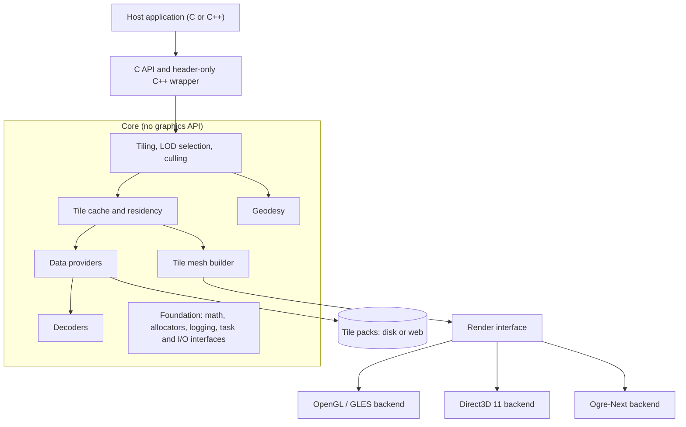
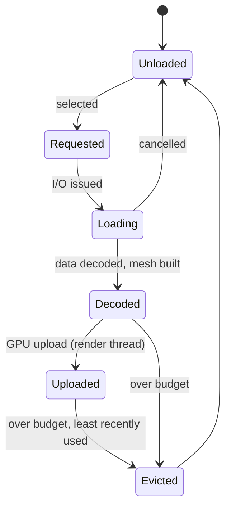
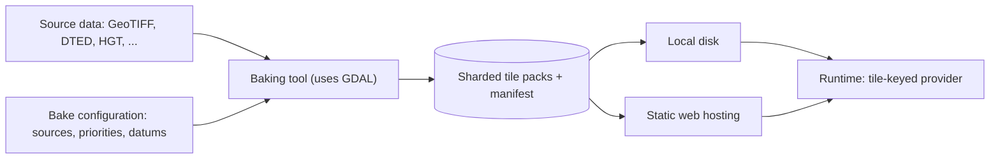

# vgl (Virtual Globe Library): Design Document

| | |
|---|---|
| **Status** | Draft 0.1 |
| **Date** | 13 October 2026 |
| **Author** | Jeremiah van Oosten |
| **Scope** | Architecture, requirements, data pipeline and roadmap. No implementation. |

The project is named **vgl** (Virtual Globe Library). This document refers to it as "the library". C API identifiers use the `vgl_` prefix and the C++ wrapper uses the `vgl` namespace (section 7.1).

---

## 1. Introduction

### 1.1 Purpose

This document describes the planned design of a lightweight C++ library for rendering a virtual globe. It covers the target audience, requirements, architecture, data pipeline and roadmap, and it records the decisions made so far together with the questions that remain open. It is also intended to confirm the requirements with prospective users, such as the client whose C project motivated the library, before implementation starts.

### 1.2 Background

The closest existing reference is Cesium Native, a set of C++ libraries for 3D Tiles streaming, glTF, high-precision geospatial math and raster overlays. Cesium Native does not render anything itself. Rendering is done by the integrations built on top of it (Cesium for Unreal, Unity, Omniverse and O3DE). It also consists of roughly two dozen libraries, including networking and cloud service clients, with a substantial dependency tree.

This library takes a different position in two ways. First, it renders: it ships with backends for specific graphics APIs and engines. Second, it is deliberately small. It has a narrow format scope, a minimal set of runtime dependencies, no built-in networking, no threads of its own and bounded memory use.

### 1.3 Summary of key decisions

| Topic | Decision |
|---|---|
| Implementation language | C++20 |
| Public ABI | C API, with a header-only C++ wrapper on top |
| Target platform | PC first; OpenGL ES 3.0+ kept possible |
| Backends | OpenGL 3.3 / GLES 3.0 common subset, Direct3D 11, Ogre-Next |
| Elevation data | Free global datasets (Copernicus GLO-30, GEBCO), baked offline |
| Runtime data format | Custom, sharded, range-readable tile packs |
| Data access | Local disk first; the client's own web hosting later, through the same interface |
| Tiling scheme | Geographic (latitude/longitude) quadtree with two root tiles |
| License | MIT |
| Repository | github.com/3dgep/vgl |

---

## 2. Goals and non-goals

### 2.1 Goals

The library should render a WGS84 globe with streamed, level-of-detail terrain and imagery inside a host application that owns the window, main loop, camera and render target. It must be usable from C as easily as from C++, so that it can be embedded in an existing C code base. It must run on Direct3D 11, OpenGL and Ogre-Next through a shared backend interface, and its core must also be usable without any backend by a host with its own renderer. Elevation and imagery data are prepared offline by a bundled baking tool and read at runtime from local files or a plain web server. The library is an open-source project hosted on GitHub, and it should be easy both to use and to extend (section 13).

### 2.2 Non-goals

The following are explicitly out of scope for the first releases: 3D Tiles and glTF streaming, text and label rendering, vector tile styling, time-dynamic data, clients for online services (Cesium ion, Google, Bing), general map reprojection at runtime, and a built-in HTTP stack. Several of these may be reconsidered later (see section 14), but the architecture should not be shaped around them.

---

## 3. Target audience and use cases

The library is "embedded" in the sense of being embeddable in a host application, rather than targeting embedded hardware. It has two kinds of users.

**Integrators** add a globe view to an existing application. The client's C project is the primary example and the main design driver. Integrators need a small, stable C API, predictable resource use, and a library that cooperates with their existing rendering instead of taking it over.

**Engine users** want the globe inside a scene graph. For them, the Ogre-Next backend maps globe tiles onto the engine's own objects and materials.

Typical applications include simulation and training, mission and route planning, moving-map displays, and visualization tools that need a 3D geographic context. Many of these involve a vehicle or aircraft positioned on the terrain, which makes height queries and correct depth interaction with host geometry important requirements.

---

## 4. Platform and toolchain

The initial target is desktop PC hardware. Direct3D 11 is available on Windows only, so the OpenGL backend provides coverage on other desktop platforms. OpenGL ES 3.0 and later is not a target for the first releases, but it must remain possible. Section 7.6 lists the rules the OpenGL backend follows to keep that option open. OpenGL ES 2.0 is out of scope.

The client's toolchain includes a C++ compiler, so the C API wraps a C++ implementation and no part of the core needs to be written in C. The baseline language level is C++20. It is supported by all current desktop compilers and leaves headroom for older vendor toolchains if a GLES device is added later.

---

## 5. Requirements

### 5.1 Functional requirements

| ID | Requirement |
|---|---|
| FR-01 | Render the WGS84 ellipsoid with terrain and imagery at continuously varying level of detail. |
| FR-02 | Select tiles by screen-space error, with view frustum and horizon culling. |
| FR-03 | Read elevation and imagery from baked tile packs on local disk. |
| FR-04 | Read the same packs from a web server through a host-supplied I/O callback, without changes to the core. |
| FR-05 | Stack several packs per layer by priority, so regional packs refine a global base. |
| FR-06 | Answer height queries at any latitude and longitude, as ellipsoidal height or height above mean sea level, at the best resolution currently loaded. |
| FR-07 | Support picking: intersect a ray with the ellipsoid and the loaded terrain. |
| FR-08 | Expose attribution strings for the data currently visible, so the host can display credits. |
| FR-09 | Provide geodetic utilities: geodetic, ECEF and local East-North-Up conversions. |
| FR-10 | Expose a backend-independent description of visible tiles, so a host can render with its own engine. |
| FR-11 | Provide a baking tool that converts source elevation and imagery into tile packs. |

### 5.2 Non-functional requirements

| ID | Requirement |
|---|---|
| NFR-01 | The public ABI is a C API. It is stable across compilers and standard library versions. |
| NFR-02 | The library never creates threads or opens network connections itself. |
| NFR-03 | All allocations can be routed through host-supplied allocator callbacks. |
| NFR-04 | CPU cache and GPU residency are bounded by budgets set at context creation. |
| NFR-05 | No exceptions cross the API boundary. The library can be built without exceptions and RTTI. |
| NFR-06 | No global state: all state lives in an explicit context object. |
| NFR-07 | The runtime has minimal third-party dependencies. Heavy dependencies (GDAL) are confined to the baking tool. |
| NFR-08 | The backends restore any graphics state they change, and document which state they touch. |
| NFR-09 | No visible jitter at any camera distance, from orbit down to ground level. |
| NFR-10 | The library works in a single-threaded host, using a time-budgeted synchronous update. |

---

## 6. Architecture

### 6.1 Overview

The library separates a renderer-independent **core**, which turns geospatial data into GPU-ready data, from **backends**, which draw it. The core never calls a graphics API. This keeps the backends small and makes the core usable on its own.

### 6.2 Modules

| Module | Responsibility |
|---|---|
| Foundation | Allocator hooks, logging callback, double-precision math, task and I/O callback interfaces |
| Geodesy | Parameterized ellipsoid (WGS84 by default), coordinate conversions, geoid model, bounding volumes |
| Tiling and selection | Geographic quadtree, screen-space error, frustum and horizon culling, load prioritization |
| Cache and residency | Tile state machine, CPU and GPU budgets, least-recently-used eviction |
| Data providers | Tile-keyed access to packs, layering by priority, shard lookup |
| Decoders | Elevation and image decoding, pluggable so a host can substitute its own |
| Tile mesh builder | Terrain meshes from heightmaps, skirts, normals, imagery texture coordinates |
| Render interface | The contract between core and backends |
| Backends | OpenGL / GLES, Direct3D 11, Ogre-Next |
| Optional defaults | Thread pool and filesystem reader, used by the samples and available to hosts |

### 6.3 Host integration model

The host owns the window, the main loop, the camera and the render target. Each frame, the host passes the camera (in double precision) and the viewport to the library and calls an update function, which advances loading and selection within a time budget. It then asks the backend to draw the globe into the host's current render pass. The library never presents, swaps buffers or clears the render target.

---

## 7. Detailed design

### 7.1 Public API and ABI

The C API follows these conventions, which are specified in full in the [C API conventions](c-api.md):

- All objects are opaque handles with explicit create and destroy functions.
- Every function returns a result code. There are no exceptions and no `errno`-style global error state.
- Option structures carry a version tag or size field, so new fields can be added without breaking the ABI.
- Positions and distances crossing the API are double precision.
- Callbacks take a user-data pointer.
- The thread-safety of each function is documented.

The header-only C++ wrapper adds RAII handles, spans, enum classes and error reporting on top of the C API. It does not introduce a second ABI, so C and C++ users link the same binary.

Naming follows a fixed convention. Functions use lowercase snake case with the `vgl_` prefix, naming the object before the action (for example `vgl_context_create`). Types use the same prefix (`vgl_context`, `vgl_result`). Constants and macros use `VGL_`, followed by the type name and the value (for example `VGL_RESULT_OUT_OF_MEMORY`). The C++ wrapper lives in the `vgl` namespace.

### 7.2 Geodesy and coordinate systems

All CPU-side geometry is double precision. The geodesy module provides conversions between geodetic coordinates, Earth-centred Earth-fixed (ECEF) coordinates and local East-North-Up frames, plus oriented bounding boxes and bounding spheres for tiles. The ellipsoid is a parameter rather than a constant, which costs nothing now and makes other bodies (the Moon, Mars) possible later.

Terrain heights are stored relative to the WGS84 ellipsoid. A small geoid grid (EGM2008) lets the library convert to and from height above mean sea level, which users of height queries will usually expect.

### 7.3 Tiling scheme and level of detail

Terrain and imagery share one geographic quadtree. Level 0 has two root tiles of 180° by 180°, and each level splits every tile into four. The scheme covers the poles, which Web Mercator cannot, and matches how source elevation data is usually gridded. Because imagery and terrain tiles align one-to-one, building meshes and mapping textures onto them stays simple.

Tile selection uses screen-space error: a tile is refined when its geometric error, projected to the screen, exceeds a threshold in pixels. Tiles outside the view frustum, or hidden below the horizon, are culled. Culling a tile before its children are loaded requires their bounds, so each tile records the minimum and maximum heights of its children (see section 8.4).

Pyramids are sparse. High resolution exists only where the source data supports it, and each tile carries a child-existence mask so the runtime knows whether refining is possible.

### 7.4 Tile lifecycle, cache and memory

Each tile moves through a fixed state machine:

Budgets for CPU cache memory and GPU residency are set when the context is created. Eviction is least-recently-used, but never removes tiles that are needed to render the current frame. The render path performs no allocations. A statistics query reports cache use, residency, queue depth and load times.

### 7.5 Threading and I/O

The library never spawns threads or opens sockets (NFR-02). The host supplies two callbacks:

- **Task scheduling.** The library submits decode and mesh-building work through a host callback. If no callback is supplied, the update function does this work synchronously within its time budget.
- **I/O.** The library requests data by URI and byte range through a host callback, and receives the result asynchronously.

GPU uploads happen only on the render thread, in a budgeted step at the start of each frame.

The optional defaults module provides a small thread pool and a filesystem reader, so the common case works without writing callbacks. The samples use these defaults.

### 7.6 Rendering

#### Backend interface

The interface is resource-oriented, not draw-call oriented. The core tells the backend when a tile's mesh or texture becomes available, changes or is evicted. Each frame, it hands over the visible set with per-tile transforms and parameters. The Direct3D 11 and OpenGL backends turn that into draw calls. The Ogre-Next backend turns it into renderables in Ogre's scene graph. If the interface fits both a raw graphics API and a scene-graph engine, it is general enough for hosts that want to render the visible set themselves (FR-10).

The material model is deliberately narrow: a terrain tile with a number of blended imagery layers. Texture formats are negotiated per backend from the start, so compressed formats (BC1 and BC7 on desktop, ETC2 and ASTC on GLES) can be added later without changing the interface.

#### Precision

GPU vertex positions are single precision and stored relative to each tile's centre. The model-view matrix for each tile is composed in double precision on the CPU and converted to single precision only at the end. This removes vertex jitter at all camera distances (NFR-09).

#### Depth

Planet-scale rendering needs a very large depth range. The primary approach is reversed-Z with a 32-bit floating-point depth buffer, which Direct3D 11 supports directly and OpenGL supports through clip control (OpenGL 4.5 or `ARB_clip_control`). Where clip control is unavailable, as on GLES, the backend falls back to a logarithmic depth buffer computed in the shader.

The depth convention is exposed to the host, because host geometry such as an aircraft on the terrain has to depth-test correctly against the globe.

#### State hygiene

The Direct3D 11 and OpenGL backends draw into the host's context. Each backend documents exactly which state it changes and restores that state before returning (NFR-08).

#### OpenGL and OpenGL ES backend

The backend targets the common subset of OpenGL 3.3 core and OpenGL ES 3.0. Desktop-only features are allowed only as detected, optional enhancements. In practice, this means the following:

- Shaders use the shared GLSL 3.30 / 3.00 ES dialect, with a version and precision preamble. There are no geometry or tessellation shaders and no double-precision arithmetic in shaders.
- Clip control is an enhancement. The logarithmic depth path is maintained and tested even though desktop drivers rarely need it.
- There are no BGRA uploads, no RGB8 render targets and no other desktop-only formats.
- Buffers, vertex array objects, samplers and uniform buffers are used only in ways that exist in ES 3.0. Wireframe rendering is a debug-only feature.
- Context creation belongs to the host, so EGL, WGL and GLX never appear in the library.

Continuous testing keeps the GLES path working: the GL sample also runs on a GLES 3 context through ANGLE on Windows and Mesa on Linux.

#### Direct3D 11 backend

The backend targets Direct3D 11 at feature level 11_0. Direct3D 12 offers little benefit for a globe renderer and would make the backend several times larger, so it is not planned.

#### Ogre-Next backend

The backend assumes Ogre-Next; the client is confirming the version. Materials go through Ogre-Next's HLMS, using a small custom HLMS implementation or custom pieces added to an existing one. Ogre-Next provides its own render systems, so this backend never touches a graphics API directly. Its depth configuration has to match the conventions of the other backends.

---

## 8. Data pipeline

### 8.1 Overview

The runtime reads only baked tile packs. All handling of source formats takes place in an offline baking tool that ships with the library but never runs inside the client's application.

### 8.2 Baking tool

The baker is a command-line tool built on a library, so a graphical front end can be added later. It uses GDAL to read source formats, reproject and mosaic. GDAL is MIT-licensed and is confined to the baker (NFR-07). Proprietary formats such as ECW and MrSID need vendor SDKs and are not supported.

The baker and the runtime link the same geodesy and tiling module, so tile addressing, bounds and sample placement have a single source of truth. A mismatch of even half a sample would produce seams.

A configuration file lists the sources with their priorities, vertical datums and nodata handling, together with the output settings. Where sources overlap, the higher-priority source wins.

A full global bake runs for many hours, so the baker is multithreaded, resumable and deterministic. Work is partitioned into units that match the output shards (section 8.5). A failed unit can be rerun on its own, units can be distributed across machines, and a regional update is simply a smaller job list. A separate validation command reports coverage and level counts and checks for seams. A fast preview mode, such as GLO-90 only or a limited number of levels, produces a test dataset in minutes.

### 8.3 Vertical datums

Source datasets use different height references. Copernicus DEM heights are relative to the EGM2008 geoid, NASADEM to EGM96, and GEBCO is effectively mean sea level. Geoid and ellipsoid differ by up to about 100 metres. Each source in the bake configuration therefore declares its vertical datum, and the baker converts all heights to WGS84 ellipsoidal heights. Without this step, visible steps of tens of metres would appear where packs from different sources meet. The datum used is recorded in the pack metadata.

### 8.4 Tile encodings

**Elevation.** Elevation tiles are regular heightmap grids, not pre-triangulated meshes. A grid is simple to bake, the runtime builds the mesh, and height queries and picking are exact and cheap. The stored tile size is 129 × 129 samples, including the border row and column shared with neighbouring tiles. Samples are 16-bit integers with a per-tile scale and offset, compressed losslessly with a predictor and Zstandard. Cracks between tiles at different levels are hidden by skirts generated at runtime.

Each tile also stores a four-bit child-existence mask and the minimum and maximum heights of its children, for culling (section 7.3).

Coarser levels are built bottom-up by filtering. The default filter averages. A maximum-preserving filter is available as a bake option for applications such as aviation, where terrain should never appear lower than it really is.

**Imagery.** Imagery tiles are 256 or 512 pixels square, stored as JPEG or WebP when opaque and PNG when alpha is needed. The baker can optionally pre-encode tiles to BC1 or BC7, which the runtime can then upload without decoding.

### 8.5 Pack format

The runtime format is a custom, range-readable pack format, inspired by PMTiles. PMTiles itself is built around Web Mercator tile identifiers and does not fit the geographic scheme.

**Sharding.** A global 30-metre dataset is far too large for a single file. Each layer is therefore split into shards, each holding one subtree of the quadtree, for example one shard per tile at level 6 (to be tuned during test bakes). Levels above the shard level go into one base shard. A small manifest describes which shards exist, their coverage, the tiling scheme, encodings, vertical datum, attribution and baker version.

Sharding makes partial installs possible (only the regions a user needs), makes updates cheap (rebaking a region replaces only its shards), and keeps individual files at a manageable size for copying and web hosting.

**Indexing.** Each shard carries its own tile directory, and the runtime loads directories only for shards it is visiting. A flat global index of tens of millions of entries is never loaded. All offsets are 64-bit.

**Layering.** The runtime stacks several packs per layer by priority (FR-05). A global base pack and regional high-resolution packs then combine without rebaking, and new data for an area is a new regional pack.

### 8.6 Data providers

The runtime's provider interface is tile-keyed ("return the bytes of tile L/X/Y in this layer"), not byte-range-keyed. Several implementations can sit behind it:

| Provider | Description | Milestone |
|---|---|---|
| Pack on disk | Reads shards from the local filesystem | MVP |
| Pack over HTTP | Reads the same shards through HTTP range requests, via the host's I/O callback | After MVP |
| Tile endpoint | Fetches individual tiles from a web API, for example to add access control | Later |
| Disk cache | Wraps a remote provider and keeps visited tiles available offline | After MVP |

---

## 9. Data sources and licensing

The client has no elevation data and a limited budget, so the default datasets are free.

| Dataset | Resolution | Coverage | License and conditions |
|---|---|---|---|
| Copernicus DEM GLO-30 | 1 arc-second (≈30 m) | Global land | Free license; adapted data must be credited as "produced using Copernicus WorldDEM-30 © DLR e.V." |
| Copernicus DEM GLO-90 | 3 arc-seconds (≈90 m) | Global land | Free license; equivalent attribution |
| GEBCO grid | 15 arc-seconds (≈450 m) | Global, including oceans | Public domain; commercial use permitted; source must be acknowledged |
| NASADEM | 1 arc-second (≈30 m) | Land between 60° N and 56° S | Public domain |

The default bake stacks GLO-30 over GEBCO. GEBCO provides the oceans and fills any gaps. NASADEM is supported as an alternative source, for use where local quality issues in GLO-30 are found.

Copernicus DEM is a surface model, not a bare-earth terrain model: buildings and vegetation are part of the surface. This suits views from the air and is less accurate for ground vehicles. A global bare-earth alternative (FABDEM) exists, but its license appears to be non-commercial and needs checking before it is considered.

The client provides imagery. The same baker, pack format and distribution design apply to it.

Attribution is a first-class feature: pack metadata carries attribution strings, and the runtime reports the credits for visible data (FR-08).

**Sources.** Copernicus DEM: dataspace.copernicus.eu (official portal; includes the GLO-30 tiles for Armenia, Azerbaijan and Moldova released in December 2023) and registry.opendata.aws/copernicus-dem (Cloud Optimized GeoTIFF mirror of the 2021 release). GEBCO: gebco.net. NASADEM: NASA LP DAAC, via a free Earthdata account.

---

## 10. Data volume and distribution

### 10.1 Size estimates

Source resolution and tile levels do not line up exactly: with 129-sample tiles, the deepest level is either level 12 (≈38 m spacing at the equator, slightly coarser than the source) or level 13 (≈19 m, oversampled). This choice dominates the dataset size and will be made after a regional test bake.

| Dataset | Deepest level | Estimated baked size |
|---|---|---|
| Global GLO-90 | 10 or 11 | Roughly 15 to 40 GB |
| Global GLO-30 | 12 (≈38 m) | Roughly 100 to 150 GB |
| Global GLO-30 | 13 (≈19 m, oversampled) | Several hundred GB |
| GEBCO base | 8 or 9 | Under 2 GB |

These are order-of-magnitude estimates. They assume 2:1 to 3:1 lossless compression and about one third extra for the coarser pyramid levels. The geographic scheme also oversamples in longitude at high latitudes, where meridians converge. How far per-tile depth limits can reduce this without losing latitude detail will be measured in the test bake. Imagery at comparable resolution will be considerably larger than elevation.

### 10.2 Distribution and hosting

At this size, streaming from a web server becomes the main way most installations receive data. Desktop installations stream tiles and keep a local disk cache. Fully offline installations receive selected shards, as a regional download or on a drive.

Because shards are plain range-readable files, the first version of the client's web API needs no server code. Any web server, CDN or object store that supports HTTP range requests works. On a small budget, data transfer fees typically matter more than storage costs, so hosting options without egress charges are worth comparing. A tile endpoint can be added later if access control or per-tile caching is needed, without changes to the runtime core.

---

## 11. Samples

| Sample | Purpose |
|---|---|
| OpenGL | Reference sample using GLFW for the window and context |
| OpenGL ES | The same sample on a GLES 3 context, through ANGLE or EGL |
| Direct3D 11 | Plain Win32 window and device |
| Ogre-Next | Globe inside an Ogre-Next scene |
| Pure C | The OpenGL sample written in C against the C API. This mirrors the client's integration; if it is awkward to write, the API needs to change. |
| Headless | Runs tile selection and loading with a scripted camera and prints statistics, without a GPU. Doubles as a test and benchmark. |

All samples use a small dataset baked from public-domain sources, so they work offline and also exercise the baker.

---

## 12. Build, testing and licensing

### 12.1 Build

The build uses CMake, with options to enable or disable each backend, decoder and provider. The runtime's third-party dependencies are limited to small, permissively licensed libraries: an image decoder (stb_image) and Zstandard for tile compression. The baker additionally depends on GDAL. The library builds as a static or shared library and installs both a CMake package and a pkg-config file, since C projects often use the latter.

### 12.2 Testing

| Area | Approach |
|---|---|
| Geodesy | Comparison against reference values from GeographicLib |
| Tile selection | Deterministic tests in headless mode with scripted camera paths |
| Baker | Bakes of synthetic, analytically defined surfaces, checking heights, seams and datum conversion |
| Pack format | Round-trip and corruption tests |
| Backends | Image comparison tests for each backend, including the GLES path through ANGLE and Mesa |
| C API | The pure-C sample built and run in continuous integration |

### 12.3 Licensing

The library is released under the MIT license. It lets commercial integrators link the library into closed-source products, requires only that the copyright and license notice are kept, and is compatible with both GPLv2 and GPLv3 projects. All runtime and baker dependencies (stb_image, Zstandard, GDAL, Ogre-Next, GLFW, ANGLE) use permissive licenses; their notices are included in distributions. Jeremiah van Oosten retains the copyright and publishes the library as open source on GitHub at github.com/3dgep/vgl. The client, like every other user, uses it under the MIT license. External contributors keep the copyright to their own contributions and license them under MIT, confirmed by a Developer Certificate of Origin sign-off on each commit. Baked datasets carry the attribution requirements of their sources (section 9), independently of the code license.

---

## 13. Open source and extensibility

### 13.1 Extension points

Everything the built-in components rely on is public. The built-in backends, providers and decoders are implemented against the same interfaces that third parties use, so they double as reference implementations. An extension builds against the installed headers and needs no fork of the library.

| Extension point | Typical extensions |
|---|---|
| Render interface | New backends (Vulkan, bgfx), or a host engine's own renderer |
| Data providers | New storage or transport, such as a custom web API or an encrypted pack |
| Decoders | Hardware JPEG decoding, additional image or elevation encodings |
| Task scheduler and I/O callbacks | Integration with a host's job system and file or network layer |
| Allocators and logging | Integration with a host's memory tracking and log output |

In C, each extension point is a table of function pointers with a user-data pointer. The C++ wrapper adapts C++ classes onto these tables, so extensions can be written naturally in either language. Each interface carries its own version number, so it can evolve without breaking existing extensions.

### 13.2 Ease of use

A minimal integration needs only four steps: create a context, add a pack, pass the camera each frame, and call the backend's draw function. Every other setting has a sensible default, including the default thread pool and filesystem reader. Errors are reported through result codes and a log callback whose messages say what went wrong and how to fix it.

Documentation consists of an API reference generated from the headers, a getting-started guide for each backend, the pack format specification, a manual for the baking tool, and the samples as worked examples.

### 13.3 Versioning and stability

The library follows Semantic Versioning. Within a major version, the C ABI stays compatible: new functionality arrives as new functions and as new fields in versioned option structures. The pack format has its own version number, independent of the library version, and the runtime reads all older pack versions within its major version. Before version 1.0, breaking changes are allowed but are documented in a changelog.

### 13.4 Repository and contributions

The repository is public at github.com/3dgep/vgl, with continuous integration through GitHub Actions on Windows and Linux. CI builds every backend, runs the tests, and runs the GLES path through ANGLE and Mesa and the headless sample. Contribution guidelines describe the coding style (enforced with clang-format and clang-tidy), the DCO sign-off and the review process, and issue templates cover bug reports and feature requests. Packages for vcpkg and Conan can follow once the API has stabilized.

---

## 14. Roadmap

| Milestone | Content |
|---|---|
| M0: Foundations | Public GitHub repository with CI and contribution guidelines, build system, foundation and geodesy modules, tiling scheme, pack format specification, C API conventions |
| M1: Data pipeline | Baker with GDAL input, datum conversion, elevation and imagery encoding, sharded packs; regional test bake to settle tile size, deepest level and shard level |
| M2: MVP runtime | LOD selection and culling, cache and budgets, pack-on-disk provider, mesh builder, OpenGL and Direct3D 11 backends, height queries, attribution; OpenGL, Direct3D 11, pure-C and headless samples |
| M3: Integration | Ogre-Next backend and sample, GLES sample in CI, multiple imagery layers, picking, atmosphere |
| M4: Distribution | HTTP pack provider, disk cache, full global bake, hosting setup |
| Later | Compressed GPU textures, vector overlays rasterized into tiles, Vulkan backend, a limited subset of 3D Tiles |

The backend used by the client's C project should be built first within M2, since that integration has to work.

---

## 15. Risks

| Risk | Impact | Mitigation |
|---|---|---|
| Dataset size and bake time exceed expectations | Delays, hosting cost | Early regional test bake; partitioned, resumable bakes; preview mode |
| Surface-model artifacts (forests, buildings) | Unrealistic terrain for ground-level use | Document the limitation; NASADEM as alternative source; review bare-earth options |
| Oversampling at high latitudes | Larger datasets | Measure in test bake; per-tile depth limits |
| Graphics state interference with the host | Rendering bugs in the host application | Documented and restored state; integration tests in a host-like sample |
| Ogre-Next version not yet confirmed | Rework of the Ogre backend | Build the Ogre backend after the others (M3) |
| Scope creep towards 3D Tiles and full GIS features | Loss of the lightweight goal | Non-goals recorded in this document |
| Depth precision on GLES | Z-fighting on GLES devices | Logarithmic depth fallback, tested continuously |

---

## 16. Open questions

| # | Question | Owner |
|---|---|---|
| 1 | Which Ogre version does the client use (Ogre-Next assumed)? | Client |
| 2 | Which graphics API does the client's C project render with? This decides the first backend. | Client |
| 3 | Which operating systems must be supported: Windows only, or also Linux? | Client |
| 4 | What imagery will the client supply, at what resolution and coverage? | Client |
| 5 | Should the ocean floor be rendered (bathymetry), or the sea surface at mean sea level? | Client |
| 6 | Which hosting option will serve the data for the web API? | Client |
| 7 | Deepest elevation level (≈38 m or ≈19 m) and shard level | After test bake |

---

## Appendix A: Glossary

| Term | Meaning |
|---|---|
| ECEF | Earth-centred, Earth-fixed Cartesian coordinates |
| ENU | Local East-North-Up coordinate frame at a point on the globe |
| Geoid | Equipotential surface approximating mean sea level (EGM96, EGM2008) |
| DSM / DTM | Digital surface model (includes buildings and vegetation) / digital terrain model (bare earth) |
| SSE | Screen-space error: a tile's geometric error projected to pixels, used to choose detail levels |
| Skirt | Vertical strip along a tile edge that hides cracks between neighbouring tiles at different levels |
| Shard | One file of a tile pack, holding a subtree of the quadtree |
| HLMS | Ogre-Next's high-level material system |
| Reversed-Z | Depth mapping that stores the far plane at 0 and the near plane at 1, improving floating-point depth precision |
