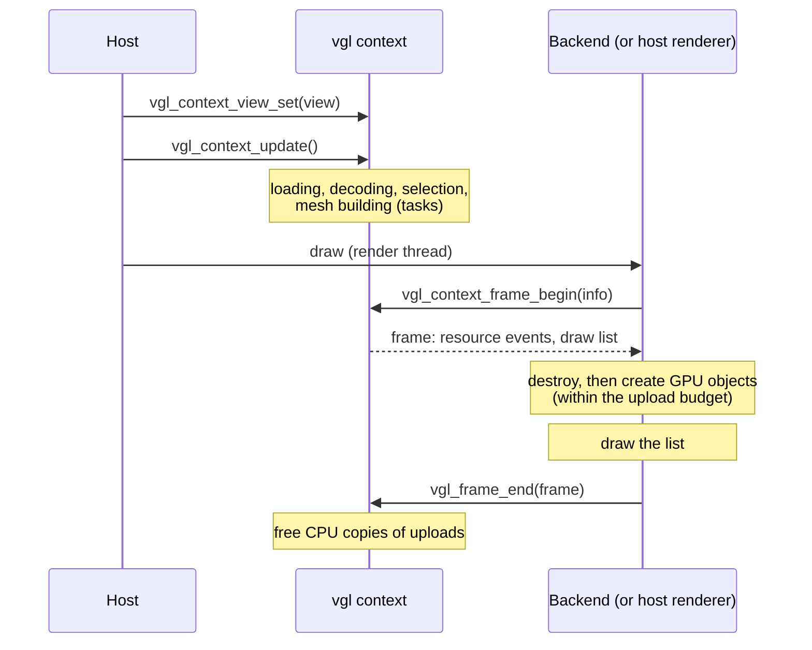

# Render interface specification

**Status: accepted on 15 October 2026, not yet implemented.** This document specifies the render interface, as the [C API conventions](c-api.md) and the [pack format](pack-format.md) specify theirs. The core, the built-in backends and third-party consumers follow it, and a change to the interface updates this document. Section 12 records the decisions and the alternatives that were considered.

This document specifies the contract between the vgl core and whatever draws the globe: the built-in OpenGL / OpenGL ES, Direct3D 11 and Ogre backends, third-party backends, and hosts that render the tiles themselves (FR-10).

## Contents

1. Requirements
2. Summary
3. Frame flow
4. Resources
5. Draw list
6. Vertex and index formats
7. Textures and format negotiation
8. Depth conventions
9. Threading
10. Fitting the consumers
11. Not covered
12. Decisions

---

## 1. Requirements

From the design document:

- **Resource-oriented** (section 7.6). The core says when a tile's mesh or texture becomes available, changes or is evicted; each frame it hands over the visible set with per-tile transforms and parameters.
- **One interface for raw APIs, scene graphs and hosts** (section 7.6, FR-10). It must suit Direct3D 11 and OpenGL draw calls, renderables in classic Ogre's scene graph, and a host engine that draws the tiles itself.
- **No jitter** (NFR-09). Vertex positions are single precision relative to each tile's centre; each tile's model-view matrix is composed in double precision and converted to single precision only at the end.
- **Budgets** (NFR-04). GPU residency is bounded by a budget set when the context is created.
- **GPU work on the render thread only** (section 7.5), in a budgeted upload step at the start of each frame. The render path performs no allocations (section 7.4).
- **Texture formats negotiated per backend** (section 7.6), so that BC1, BC7, ETC2 and ASTC can be added later without changing the interface.
- **The depth convention is exposed to the host** (section 7.6), so that host geometry depth-tests correctly against the globe.
- **State hygiene** (NFR-08). The raw backends restore every piece of graphics state they change.
- **C first** (section 13.2). It has to read naturally from C; the pure-C sample is the test.

## 2. Summary

The render interface is **pulled, not pushed**. The core never calls into a backend. Instead, the consumer brackets each frame on the render thread:

1. `vgl_context_frame_begin` returns a frame. The frame carries two lists that point into library memory and stay valid until the frame ends (C API conventions, section 6.4):
   - **resource events**: meshes, index lists and textures to create, and resources to destroy
   - the **draw list**: for each tile to draw, its resources and its model-view matrix
2. The consumer applies the events (creating and destroying its GPU objects) and draws, or hands the list to its scene graph.
3. `vgl_frame_end` closes the frame. After it, the core frees the CPU copies of what was uploaded.

The built-in backends are consumers of exactly this API, so a host that renders by itself uses the same, tested path (design document, section 13.1).

Why pull rather than a table of callbacks (the usual extension interface, C API conventions section 9.2):

- **Scene graphs.** Ogre wants to create its objects inside its own frame callbacks, not whenever the core decides. A list it can walk when it is ready fits that; callbacks would arrive at the wrong time.
- **No re-entrancy rules.** Callbacks must not call back into the context (section 9.3). A consumer that walks a list can call anything it likes.
- **C.** A loop over an array is the most natural thing in C; a table of callbacks with `user_data` casts is less so.
- **Batching.** A backend sees all of a frame's events at once, and can, for example, upload them with one staging buffer.

The cost is that the consumer must call `vgl_context_frame_begin` and `vgl_frame_end` every frame, even when nothing changed. The built-in backends do this inside their draw function, so the four-step integration of section 13.2 stays four steps.

## 3. Frame flow



The declarations, in outline; they follow the C API conventions, and details such as names may still change during implementation, which then updates this document:

```c
typedef struct vgl_frame vgl_frame;

typedef struct vgl_frame_begin_info
{
    uint32_t struct_size;
    /* sizeof(vgl_draw_item) in the consumer's header, so that the core writes draw
     * items of that size (section 5). 0 selects the size of the first version. */
    uint32_t draw_item_size;
    /* Bytes the consumer may upload in this frame. 0 selects 16 MiB. At least one
     * resource is always offered, so a large one cannot stall forever. */
    uint64_t upload_budget;
    /* Optional. The camera to compose model-view matrices for, when it differs from
     * the view of the last update (for example, the host updates at 20 Hz and draws at
     * 60 Hz). Null uses the view of the last update. */
    const vgl_dmat4* view_matrix;
} vgl_frame_begin_info;

vgl_result vgl_context_frame_begin(vgl_context* context,
                                   const vgl_frame_begin_info* info,
                                   vgl_frame** out_frame);

/* Views into library memory, valid until vgl_frame_end. */
vgl_result vgl_frame_resource_events_get(const vgl_frame* frame,
                                         const vgl_resource_event** out_events,
                                         uint32_t* out_count);
vgl_result vgl_frame_draw_list_get(const vgl_frame* frame,
                                   const vgl_draw_item** out_items,
                                   uint32_t* out_count);

/* Optional: a handle the consumer wants back in later draw items, for example a
 * pointer to its own buffer object, to avoid a lookup per draw. */
vgl_result vgl_frame_resource_handle_set(vgl_frame* frame, uint64_t resource, uint64_t handle);

/* Optional: the consumer could not create a resource (for example, out of GPU memory). */
vgl_result vgl_frame_resource_failed(vgl_frame* frame, uint64_t resource, vgl_result reason);

vgl_result vgl_frame_end(vgl_frame* frame);
```

## 4. Resources

### 4.1 Kinds and identity

There are three kinds of resource:

| Kind | Contents | Shared |
|---|---|---|
| Mesh | A tile's vertices (section 6) | No: one per tile and data source |
| Index list | The triangle list of one grid size | Yes: by every mesh of that grid size |
| Texture | One imagery tile, in a negotiated format (section 7) | No |

Each resource has a 64-bit identifier, unique within the context and never reused. The consumer maps identifiers to its own objects, or sets a handle (section 3) that the core echoes in later draw items.

### 4.2 Events

```c
typedef enum vgl_resource_event_type
{
    VGL_RESOURCE_EVENT_TYPE_DESTROY = 1,
    VGL_RESOURCE_EVENT_TYPE_MESH_CREATE = 2,
    VGL_RESOURCE_EVENT_TYPE_INDEX_LIST_CREATE = 3,
    VGL_RESOURCE_EVENT_TYPE_TEXTURE_CREATE = 4,
    VGL_RESOURCE_EVENT_TYPE_MAX_ENUM = 0x7FFFFFFF
} vgl_resource_event_type;

typedef struct vgl_resource_event
{
    vgl_resource_event_type type;
    uint32_t reserved;
    uint64_t resource;
    /* For the create events: the data, valid until vgl_frame_end. One of these,
     * by type; the others are null. */
    const vgl_mesh_data* mesh;
    const vgl_index_list_data* index_list;
    const vgl_texture_data* texture;
} vgl_resource_event;
```

- In each frame, destroy events come first, so that their memory is free before anything new is created.
- A resource appears in the draw list only after its create event has been delivered, in that frame or an earlier one, and never after its destroy event.
- After `vgl_frame_end`, the core treats every create event as done, unless the consumer called `vgl_frame_resource_failed`. A failed resource is offered again in a later frame, and the failure is logged.

### 4.3 Upload budget and the GPU budget

- **Upload budget.** A frame offers create events up to `upload_budget` bytes, coarsest tiles first, so a large view change spreads its uploads over several frames instead of one long one.
- **GPU budget.** `vgl_context_create_info` gains a `gpu_budget` (0 selects a default, perhaps 512 MiB). The core adds up the sizes of the resources it has asked the consumer to create. While the total exceeds the budget, it issues destroy events for resources not drawn in the current frame, least recently drawn first. The consumer never decides what to evict; it only does what the events say.
- **No holes.** A region keeps what it drew last frame until all the resources that replace it are resident, the same rule selection follows for loading (design document, section 7.3).

### 4.4 CPU copies and device loss

Once a mesh or texture has been uploaded, the core frees its CPU copy, and only its GPU copy counts, against the GPU budget. This is what keeps memory in check: today a mesh of 129 × 129 samples takes about 400 KB, so a view with 550 tiles fills the default CPU budget with meshes alone.

The price is device loss. If the consumer loses its GPU objects (a lost Direct3D device, a destroyed OpenGL context, an Android app sent to the background), it calls:

```c
/* Forget every resource: the consumer has lost them all. They are rebuilt from the
 * decoded tiles and offered again as create events, within the upload budget. */
vgl_result vgl_context_resources_reset(vgl_context* context);
```

Rebuilding takes a few frames, during which coarser tiles are drawn, and longer if the decoded tiles were evicted too.

## 5. Draw list

```c
typedef struct vgl_tile_id
{
    uint32_t level;
    uint32_t x;
    uint32_t y;
    uint32_t reserved;
} vgl_tile_id;

typedef struct vgl_draw_layer
{
    uint64_t texture;          /* Resource. */
    uint64_t texture_handle;   /* As set by vgl_frame_resource_handle_set, or 0. */
    float uv_scale_offset[4];  /* Maps the mesh's texture coordinates into the texture,
                                  for a tile drawn with an ancestor's imagery. */
    float opacity;
    uint32_t reserved;
} vgl_draw_layer;

typedef struct vgl_draw_item
{
    vgl_tile_id tile;
    uint64_t mesh;
    uint64_t mesh_handle;
    uint64_t index_list;
    uint64_t index_list_handle;
    uint32_t index_count;
    uint32_t layer_count;
    const vgl_draw_layer* layers;  /* Imagery, bottom first. */
    float model_view[16];          /* Mesh coordinates to camera space, column-major;
                                      composed in double, rounded at the end. */
    vgl_dvec3 centre;              /* ECEF origin of the mesh coordinates, for consumers
                                      that compose their own transforms. */
    double min_height;
    double max_height;
} vgl_draw_item;
```

- **Transforms.** The core composes `view × translate(centre)` in double precision and rounds the result to `float`, so consumers get jitter-free matrices without doing any double-precision work. The projection stays with the consumer, since only the consumer knows its depth convention (section 8). An engine that composes transforms itself uses `centre`.
- **Order.** Items are sorted by distance from the camera, nearest first, which helps early depth rejection. Consumers may reorder them.
- **Layers.** The material model is the design's narrow one: a terrain tile with imagery layers blended bottom to top. A tile with no imagery has no layers; backends then shade by height and normal.
- **Growth.** The draw list is an array, so consumers step through it by `sizeof(vgl_draw_item)` of the header they were compiled against. To keep that safe, `vgl_frame_begin_info` has a field in which the consumer states that size, and the core writes items of that size. Fields are only ever appended.

## 6. Vertex and index formats

Meshes use the layout the mesh builder already produces (design document, section 7.3, "Tile meshes"), fixed for the major version and described by constants rather than a runtime query:

| Offset | Attribute | Format |
|---|---|---|
| 0 | Position relative to the tile's centre, along the ECEF axes | 3 × `float` |
| 12 | Height above the ellipsoid | `float` |
| 16 | Texture coordinates over the tile (*u* east, *v* south) | 2 × unsigned 16-bit normalized |
| 20 | Normal, octahedral encoding | 2 × signed 16-bit normalized |

The stride is 24 bytes. Every one of these formats exists in OpenGL ES 3.0 and Direct3D 11, and in recent classic Ogre releases as `VET_FLOAT3`, `VET_FLOAT1`, `VET_USHORT2_NORM` and `VET_SHORT2_NORM`; to be confirmed for the client's release (design document, section 16, question 1).

Index lists are 16-bit when the mesh has at most 65,536 vertices (grids up to 254 × 254 with their skirts, which covers the 129-sample tiles of the test bake), and 32-bit above that; the event says which. Triangles are counter-clockwise seen from outside the ellipsoid, in right-handed ECEF. A consumer whose camera space is left-handed, as is common with Direct3D, sees them clockwise and sets its culling mode to match; the backend knows its convention, so the data does not need to say.

## 7. Textures and format negotiation

The consumer states once, when its backend is created, which formats it can sample:

```c
typedef enum vgl_texture_format
{
    VGL_TEXTURE_FORMAT_RGBA8 = 1,       /* Always supported. */
    VGL_TEXTURE_FORMAT_RGBA8_SRGB = 2,
    VGL_TEXTURE_FORMAT_BC1 = 3,
    VGL_TEXTURE_FORMAT_BC7 = 4,
    VGL_TEXTURE_FORMAT_ETC2_RGB8 = 5,
    VGL_TEXTURE_FORMAT_ASTC_4X4 = 6,
    VGL_TEXTURE_FORMAT_MAX_ENUM = 0x7FFFFFFF
} vgl_texture_format;

vgl_result vgl_context_texture_formats_set(vgl_context* context,
                                           const vgl_texture_format* formats,
                                           uint32_t format_count);
```

For each imagery tile, the core picks the first of the consumer's formats it can produce: the pack's own pre-encoded format if the consumer lists it (the baker can pre-encode BC1 or BC7, design document section 8.4), and otherwise RGBA8, decoded from JPEG, WebP or PNG. Only RGBA8 needs to work in the MVP; the compressed formats are later work that needs no interface change.

Texture events carry the format, the size, the mip level count and a pointer per mip level. Mip levels are generated by the core on a task thread, because OpenGL ES 3.0 cannot generate mipmaps for every format and because generating them on the render thread would cost frame time.

Imagery itself is still an open question for the client (design document, section 16, question 4), so textures are specified here only far enough to keep the interface stable.

## 8. Depth conventions

The consumer owns the depth buffer, its clearing and the projection matrix, so it chooses the convention, and every backend supports all three:

| Convention | Projection | Depth buffer | Where |
|---|---|---|---|
| Reversed-Z | The host's, reversed (near to 1, far to 0), ideally with an infinite far plane | 32-bit float, cleared to 0, compare `GREATER` | Direct3D 11; OpenGL 4.5 or `ARB_clip_control` |
| Logarithmic | The host's, conventional | Any; the shader writes depth from the camera distance | Everywhere, including OpenGL ES and macOS |
| Conventional | The host's | Any | Small scenes only; z-fighting at planetary scale |

The backend states the convention when it is created, and fails if the device cannot do it: reversed-Z needs clip control under OpenGL. For the logarithmic convention, the frame reports the coefficient its shaders use, and the getting-started guides give the matching snippet in GLSL and HLSL, so that host geometry, such as an aircraft on the terrain, writes the same depths:

```glsl
// Vertex shader: pass camera-space distance; fragment shader:
gl_FragDepth = log2(max(1e-6, 1.0 + w)) * log_depth_coefficient * 0.5;
// with log_depth_coefficient = 2.0 / log2(far + 1.0)
```

## 9. Threading

- `vgl_context_frame_begin`, the frame functions and `vgl_frame_end` are in the **render thread** category (C API conventions, section 11): context-synchronized, and on the thread that owns the graphics device.
- They must not overlap with `vgl_context_update`, which is context-synchronized too. A host that updates on another thread than it renders must serialize the two. This keeps the MVP simple; a later version could let the update run while the previous frame is drawn, by double-buffering the draw list, without changing these declarations.
- Frame functions never allocate. The lists are built during the update and only handed out by `vgl_context_frame_begin`.

## 10. Fitting the consumers

| | Direct3D 11 / OpenGL backend | Ogre backend | Host renderer |
|---|---|---|---|
| Where the frame is | Inside `vgl_gl_draw` / `vgl_d3d11_draw`, called by the host in its render pass | In a `RenderQueueListener` or a custom `MovableObject`'s `_updateRenderQueue`, once per Ogre frame | Wherever the host draws |
| Create and destroy events | Buffers and textures from a pool; a staging buffer per frame | `HardwareVertexBuffer`, `HardwareIndexBuffer` and `Texture` objects through Ogre's managers | Its own objects |
| Draw list | One draw call per item, with a per-item constant buffer or uniform block | A pool of renderables, one per item, added to the render queue. Each reports `model_view` with `getUseIdentityView` set, so Ogre multiplies only the projection and the precision survives. | Its own draws |
| Precision | `model_view` as is | `model_view` as is; an Ogre build with `OGRE_DOUBLE_PRECISION` is not needed | `model_view`, or its own composition from `centre` |
| State | Saves and restores what it changes (NFR-08), documented per backend | Ogre's pass state; nothing to restore | Its own |

The Ogre column is the one most worth checking against the client's project once the Ogre release and render systems are known (design document, section 16, question 1).

## 11. Not covered

- **Shaders and lighting.** Each backend's material and its parameters (sun direction, atmosphere in M3) belong to that backend, not to the interface.
- **Picking** (FR-07) uses the decoded tiles on the CPU and needs nothing from the GPU.
- **Several views**, such as shadow maps or stereo, would need one draw list per view; the frame API can take a view index later.
- **Overlap between update and draw** (section 9).

## 12. Decisions

All seven were accepted as proposed.

| # | Decision | Chosen | Alternative considered |
|---|---|---|---|
| 1 | How the core and a consumer talk | Pull: per-frame lists the consumer walks (section 2) | Push: a table of callbacks, as for I/O and tasks |
| 2 | CPU copies after upload | Freed; device loss is recovered with `vgl_context_resources_reset` (section 4.4) | Kept, for instant recovery, at about twice the memory |
| 3 | Who composes transforms | The core composes `float` model-view matrices in double precision; `centre` is there as well (section 5) | Only `centre`, with every consumer doing double-precision work itself |
| 4 | Who decides the depth convention | The consumer, from three that every backend supports (section 8) | The backend picks the best the device allows |
| 5 | Update and draw on different threads | Serialized by the host in the MVP (section 9) | Overlapping from the start, with a double-buffered draw list |
| 6 | Index width | 16-bit up to 65,536 vertices, 32-bit above (section 6) | Always 32-bit, simpler but larger |
| 7 | Mip levels | Generated by the core on task threads (section 7) | Generated by each backend on the GPU |
